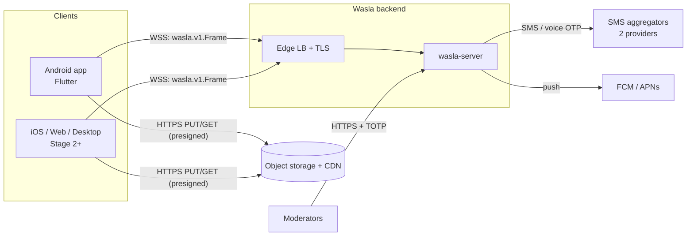
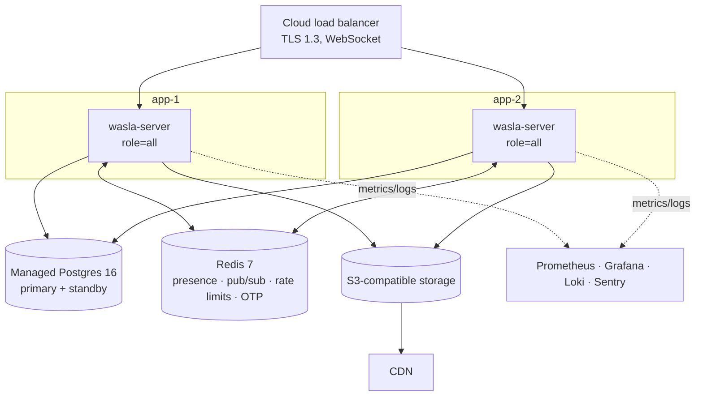
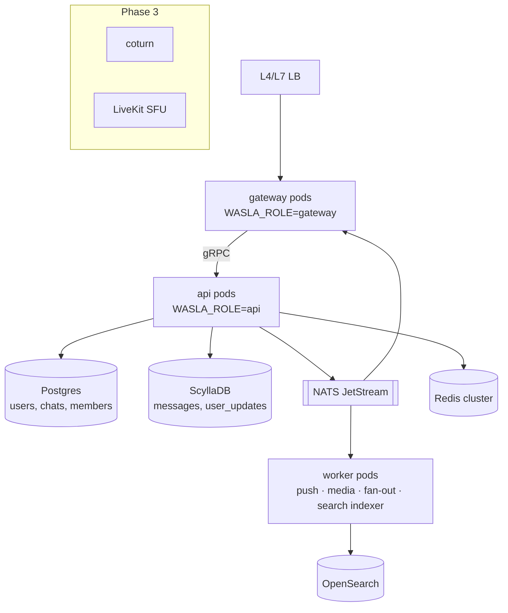
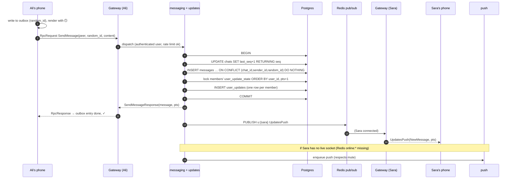
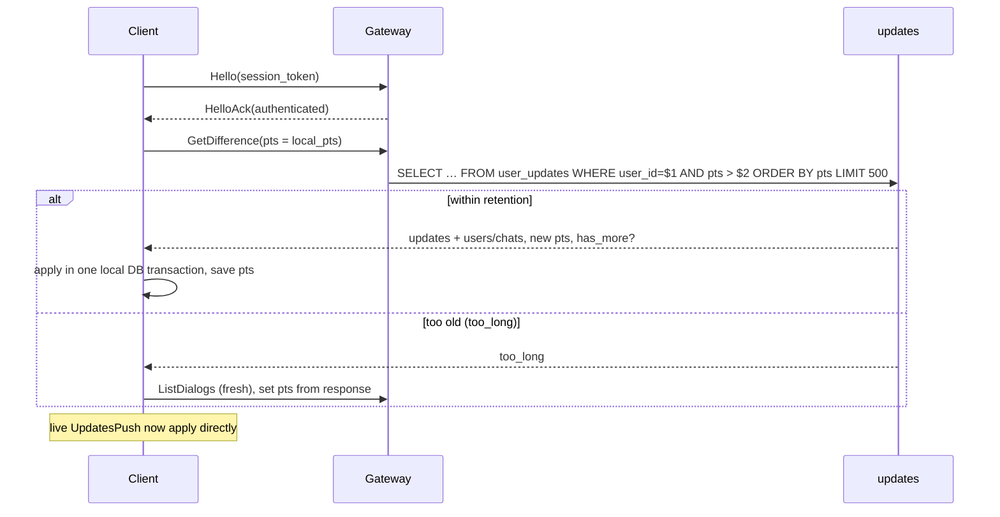
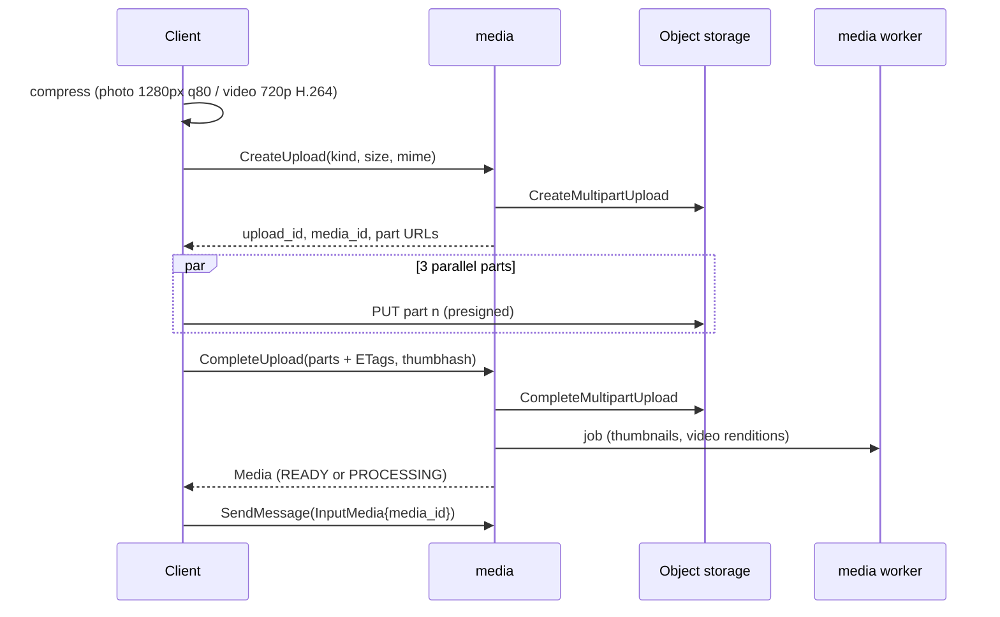

# Wasla — Architecture

Status: **Phase 0 draft for sign-off** · Scope: the Lean MVP, designed so Phases 2–5 fit without rework.

Related documents: [02-data-model.md](02-data-model.md) · [03-protocol.md](03-protocol.md) · [04-decisions.md](04-decisions.md) · [proto/](../proto/wasla/v1) · [schema](../db/postgres/migrations/0001_init.up.sql)

---

## 1. Goals and constraints

| Requirement | Design answer |
|---|---|
| Message delivery under 300 ms on good networks | One Postgres transaction per send, then a Redis publish to the recipient's gateway. No queue hop on the hot path. |
| Works on weak 3G, offline queue, auto-retry | Compressed protobuf frames; idempotent sends (`random_id`); persistent client outbox; resumable media in 512 KiB parts; exact-gap sync with `pts` |
| Instant sync across all devices | One update log per user (`user_updates`, `pts`); every device replays from its last pts |
| 20k users at launch, 200k after 12 months, millions later | Stateless gateways; modular monolith that splits by role; message store behind an interface so it can move to ScyllaDB; fan-out on read for large chats (Phase 2) |
| Low battery and data use | One socket per device; push only when the app is offline; thumbhash placeholders; media loaded lazily with per-network auto-download settings |
| Correct RTL for Arabic everywhere | Directional layout rules plus RTL and LTR golden tests in CI (§10.3) |
| Closed-source clients | Only permissively licensed dependencies (Apache, MIT, BSD) in the client; see the license list in 04-decisions |
| Possible Iraqi hosting requirement | Portable stack: Postgres, Redis, S3 API, containers, no cloud-specific services |

## 2. System context



## 3. Deployment topology

### 3.1 Lean MVP (up to about 100k users)



- **Two VMs** of 4 vCPU / 8 GB each, running Docker Compose. Either VM can take the full load, so a deploy is a rolling restart. Clients reconnect and catch up with `GetDifference`.
- **Postgres**: managed, multi-AZ, point-in-time recovery, daily snapshots copied to a second region.
- **Redis** holds nothing that cannot be lost. Losing it costs typing indicators, presence and pending OTPs, never messages.
- **Region**: AWS me-south-1 (Bahrain) or me-central-1 (UAE), unless the CMC review (proposal §0) requires hosting in Iraq.

### 3.2 Target topology (Phase 2+, from about 100k users)



It is the same binary throughout; only `WASLA_ROLE` changes. §11 lists the triggers for each step.

## 4. Backend modules

The Go code lives in [`backend/internal/`](../backend/internal). Modules talk to each other only through Go interfaces, never through each other's tables. That rule is what makes a later split into services mechanical.

| Module | Owns (tables / keys) | Exposes |
|---|---|---|
| `gateway` | Connection state (in memory) | WebSocket `/ws`, Connect HTTP fallback, delivery of `UpdatesPush` |
| `auth` | `sessions`, `account_passwords`, `otp_requests`; Redis `otp:*` | `AuthService` |
| `users` | `users`, `profile_photos`, `privacy_*`, `user_blocks` | `UsersService`; `Visibility(viewer, target)` used by every module |
| `contacts` | `contacts` | `ContactsService` |
| `chats` | `chats`, `chat_members`, `private_chat_pairs`, `chat_invites` | `ChatsService`; `Membership(chat, user)` |
| `messaging` | `messages`, `message_hides`, `chat_pins` | `MessagesService` |
| `updates` | `user_update_state`, `user_updates`; Redis channel `u:{user_id}` | `UpdatesService`; `Append(tx, users, update)`, `Publish` |
| `media` | `media_files`; object storage | `MediaService`; processing worker |
| `push` | — (reads sessions) | Consumes "user offline + new update" events |
| `presence` | Redis `online:*`, `typing:*` | Ephemeral updates |
| `moderation` | `reports`, `moderation_actions`, `staff_users` | `ModerationService`; admin panel at `/admin` |

## 5. Key flows

### 5.1 Sending a message



- **Idempotency**: if the response is lost, the client retries with the same `random_id`. The `ON CONFLICT` branch loads the original row and returns it, so no duplicate is created.
- **Deadlock safety**: pts rows are always locked in `user_id` order. Two concurrent sends to overlapping groups therefore cannot deadlock.
- **Publishing after commit**: a crash between commit and publish loses only the live push. The recipient still gets the message on the next `GetDifference`, which runs on every reconnect and whenever a gap is detected.
- **Blocks and privacy** are checked before the transaction starts: `PEER_BLOCKED`, `CHAT_WRITE_FORBIDDEN`.

### 5.2 Reconnect and sync



The client's gap rule is described in [03-protocol.md §5](03-protocol.md).

### 5.3 Media upload



The API servers never handle file bytes. Downloads use short-lived signed CDN URLs from `GetDownloadUrl`, which checks access through a single primary-key lookup on the message, user or chat the media was seen in.

### 5.4 Login

`SendCode` checks, in order:

1. Device attestation: Play Integrity on Android, App Attest on iOS.
2. Per-IP, per-phone and per-prefix rate limits.
3. A daily SMS spend cap per country prefix.

Only then is a code sent: in-app first if the account has a logged-in device, otherwise by SMS through the primary aggregator, with voice-call fallback on resend. Codes are stored in Redis as `HMAC(code)` with a 5-minute TTL and 5 attempts. After `SignIn`, the 2FA branch issues a 10-minute `login_token`. All steps are logged to `otp_requests` for SMS cost tracking and fraud analytics.

## 6. Sync model

- **pts**: one per user. It increases by exactly 1 for each persistent update. Messages are ordered by `(chat_id, seq)`; pts orders *the events a user sees*.
- **Small chats (private, saved, groups of 200 or fewer): fan-out on write.** One `user_updates` row per member per event. With 200 members that is 200 small inserts in one statement, which is cheap.
- **Large chats (Phase 2 supergroups and channels): fan-out on read.** The chat gets its own `pts`, and events are written once to a per-chat log. Members' devices call `GetChannelDifference(chat_id, chat_pts)` when they open the chat, or when a lightweight "channel has news" ping arrives. This is the only way a channel with 1M subscribers stays affordable, and the protocol already reserves `CHAT_TYPE_SUPERGROUP` and `CHAT_TYPE_CHANNEL`.
- **Ephemeral updates** (typing, online status) go only through Redis with `pts = 0` and are never replayed.
- **Retention**: `user_updates` keeps 30 days, or the last 10,000 rows per user if that is more. Older clients get `too_long` and reload their dialogs.

## 7. Data stores

| Store | Holds | Notes |
|---|---|---|
| Postgres 16 | Everything durable in the MVP | `messages` and `user_updates` are hash-partitioned into 16 partitions with no foreign keys, so they can move to ScyllaDB. Details in [02-data-model.md](02-data-model.md). |
| Redis 7 | OTP codes, presence, typing, rate-limit buckets, pub/sub routing, short caches | Disposable; no persistence needed |
| Object storage | Media originals and renditions | Key layout `m/{media_id>>40}/{media_id}/{variant}`; lifecycle rule aborts multipart uploads older than 7 days |
| Device: SQLite (`package:sqlite3`, ADR-010) | Chats, messages (newest 200 per chat loaded at start), users, outbox, sync position (pts) | Rows hold protobuf bytes, so new fields need no migration. SQLCipher encryption is on the launch checklist. The web build keeps data in memory for now. |

## 8. Security and abuse

- **Transport**: TLS 1.3 only, HSTS, and certificate pinning in the app (with backup pins).
- **Sessions**: 256-bit random tokens, only their SHA-256 stored. Logout and revoke delete the row and close any live socket for that session.
- **2FA passwords**: argon2id (m = 64 MiB, t = 3, p = 2). Moving to SRP, so the server never sees the password, is tracked for Phase 4.
- **Phone-number enumeration** through `ImportContacts` is limited to 500 numbers per call, 2,000 new numbers per day and 10,000 per account lifetime. The rate is also reduced for accounts that are new or have no attestation.
- **Rate limits** use Redis token buckets per session, per user and per IP for each method class (send, auth, search, import). Exceeding one returns `RATE_LIMITED` with `retry_after_seconds`.
- **Media**: signed URLs that expire after 1 hour, plus content-type sniffing in the worker. EXIF location data is stripped from photos unless the user sends the photo as a file.
- **Moderation**: every report stores an evidence snapshot, and every staff action is written to `moderation_actions`. Staff log in with TOTP 2FA, only through a separate admin hostname behind an IP allowlist.
- **Secrets**: kept in environment variables from the orchestrator's secret store, never in the repository. `.gitignore` covers signing keys and Firebase configuration files.
- **Secret Chats (Phase 4)**: vodozemac's Olm (X3DH-style key agreement plus Double Ratchet) through flutter_rust_bridge, with keys stored only on the device. An external audit is required before release.

## 9. Operations

- **Environments**: `dev` (each developer's laptop, using [deploy/docker-compose.dev.yml](../deploy/docker-compose.dev.yml)), `staging` (a smaller copy of production) and `prod`.
- **CI** ([.github/workflows/ci.yml](../.github/workflows/ci.yml)): buf lint and breaking-change check, migrations up/down/up plus SQL smoke tests, Go vet and race-detector tests. The Flutter job (analyze, tests, golden tests, APK build) is added in sprint 1.
- **CD**: on a merge to `main`, build the image, deploy to staging and run smoke tests. Production deploys from a tag with manual approval. Android builds go through Codemagic to Play internal testing, then closed testing.
- **Observability**:
  - Prometheus metrics: connections, RPC p50/p95/p99 per method, send-to-deliver latency, pts lag, OTP send and success rates by prefix, push failures.
  - Logs and dashboards: Loki for logs, Grafana for dashboards and alerts.
  - Clients: Sentry for crash reporting.
  - Alerts: p99 send latency above 300 ms, gateway error rate, OTP success rate below 70% for any operator prefix, SMS spend spikes.
- **Backups**: Postgres point-in-time recovery for 7 days, daily snapshots kept for 30 days in a second region, and a restore drill every month.

## 10. Client architecture (Flutter)

### 10.1 Layers

```
features/  (UI: screens, widgets, Riverpod controllers)
   │  watch streams
core/chat (ChatStore: state the UI reads; every change is written
           through to core/storage, SQLite on the device)
   ▲  writes                      ▲ writes
core/sync (UpdateEngine: pts,     core/outbox (send queue,
 gaps, GetDifference)              retry with backoff, random_id)
   ▲                                  │
core/net  (WsClient: Hello, RPC multiplexing, reconnect, Connect fallback)
```

The UI **never** waits on the network to show data. It renders from the local database, and network responses are written into that database. That is how "instant" feels on 3G.

### 10.2 Network behaviour

- Reconnect backoff: 0.5 s, then 1, 2, 4, 8 s, capped at 30 s with jitter. Reconnect immediately when connectivity changes.
- Ping every 25 s when idle. If no frame arrives for 60 s, the connection counts as dead.
- The outbox survives app kills. Entries are retried in order per chat.
- Media auto-download settings per network type (Wi-Fi / mobile / roaming). The default on mobile data is photos only.

### 10.3 RTL rules (checked in code review and CI)

1. Use `EdgeInsetsDirectional`, `AlignmentDirectional` and `PositionedDirectional` only. Plain `left`/`right` is a lint error (custom lint rule).
2. Every icon that implies direction (back, send, reply, forward) flips with `Directionality`.
3. Message bubbles: outgoing on the **end** side. Timestamps and ✓ marks inside the bubble on the end side.
4. Mixed text: set `TextDirection` per message from its first strong character, so English replies inside Arabic chats render correctly. Phone numbers and @usernames are wrapped in LTR isolates (U+2066…U+2069).
5. Numbers use Western digits by default, with a setting for Eastern Arabic digits (٠١٢٣).
6. Golden tests render every screen in `ar` (RTL) and `en` (LTR), in light and dark themes.
7. Font: Cairo (brand font, OFL licence), bundled with the app; it covers Arabic and Latin.

## 11. Scaling path

| Trigger (measured) | Action |
|---|---|
| More than ~60k concurrent sockets, or CPU above 60% on the app VMs | Move to Kubernetes; split `WASLA_ROLE=gateway` from `api` |
| Phase 2 begins | Add supergroups and channels with fan-out on read; add NATS JetStream for worker jobs |
| `messages` above ~2 TB, or Postgres write IOPS above 70% | Move `messages` and `user_updates` to ScyllaDB; the `MessageStore` interface keeps the move to one module |
| Global message search becomes a requirement | Add OpenSearch with an Arabic analyzer, fed from NATS |
| Over 1M users | Shard Postgres by `user_id` (Citus), add regional gateways, use a multi-CDN setup |

## 12. Open questions

1. CMC hosting and moderation obligations (proposal §0). **Blocks the final region choice.**
2. SMS aggregators: shortlist two with direct routes to Asiacell, Zain and Korek, then test delivery rates in week 1.
3. Map tiles for location messages: OpenStreetMap's public tile servers are not allowed for apps at scale. Options are MapTiler or Stadia (paid tiers), or self-hosted tiles.
4. Brand assets (logo, colour palette) are needed by week 2 for the design system.
