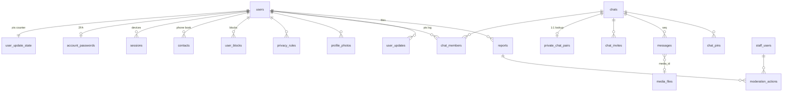

# Wasla — Data Model

Source of truth: [`db/postgres/migrations/0001_init.up.sql`](../db/postgres/migrations/0001_init.up.sql), checked in CI with migrations up/down/up plus [smoke tests](../db/postgres/tests/smoke_send_message.sql).

## 1. Entity relationships



## 2. Conventions

- **IDs**: Snowflake int64 generated in the app ([`snowflake.go`](../backend/internal/platform/snowflake/snowflake.go)). They are not sequential, so users and chats cannot be enumerated. Internal tables such as `reports` use identity columns.
- **Enum columns** are `smallint` holding the **same numbers as the protobuf enum**. For example, `chats.type` uses `wasla.v1.ChatType` values, and `messages.kind` uses the `MessageContent` oneof field number. One mapping, no translation layer.
- **Hot tables** (`messages`, `user_updates`) are hash-partitioned, have no foreign keys, and use primary keys that map directly to ScyllaDB (§6).
- **Soft delete** applies to users (`deleted_at`, and the phone number is wiped) and to messages (`deleted_at` tombstone with the content cleared, so `seq` stays continuous).

## 3. Table notes

| Table | Purpose and notable rules |
|---|---|
| `users` | Phone is unique among live accounts and NULL after deletion. Username: 5–32 characters, starts with a letter, **unique regardless of case** (`lower(username)` index), plus a prefix index for search. |
| `user_update_state` | The pts counter, kept in a separate narrow table because it is incremented constantly. |
| `account_passwords` | argon2id PHC string, hint, and recovery email. |
| `sessions` | One row per device: SHA-256 of the token, device info, push token. A partial unique index ensures a push token belongs to only one live session. |
| `otp_requests` | Audit and cost log. The codes themselves are only in Redis. Used for fraud dashboards by number prefix (e.g. +96477x, +96478x, +96475x). |
| `privacy_rules`, `privacy_exceptions` | No row means the default (§4). |
| `contacts` | Phone-book entries. `contact_user_id` is filled in when that number signs up, which also triggers a `ContactJoined` update to the owner. |
| `media_files` | Metadata only. `variants` lists the server-made renditions. `status` 1→3 tracks the upload lifecycle. Uploads that never complete are cleaned up through `media_files_pending_idx`. |
| `chats` | `last_seq` is the per-chat message counter; `last_message_at` sorts the chat list. Types 4 and 5 are reserved for Phase 2. |
| `private_chat_pairs` | `(min(a,b), max(a,b)) → chat_id`. The pair `(u, u)` is that user's Saved Messages. |
| `chat_members` | Membership **and** the per-user dialog state: read pointers, pin, archive, mute, cleared history. |
| `messages` | Primary key `(chat_id, seq)`. `UNIQUE (chat_id, sender_id, random_id)` makes retried sends idempotent. Entity offsets are in UTF-16 code units. |
| `message_hides` | "Delete for me". |
| `user_updates` | The sync log. `payload` is the serialized `wasla.v1.Update`, sent to clients as-is. |
| `reports`, `staff_users`, `moderation_actions` | Moderation queue, staff accounts, and an append-only audit trail. |

## 4. Privacy defaults

| Key | Default | Notes |
|---|---|---|
| `PHONE_NUMBER` | CONTACTS | Visible only to people the user has saved as contacts |
| `LAST_SEEN` | EVERYBODY | Reciprocal: if you hide your exact last seen, you see only approximate values for others |
| `PROFILE_PHOTO` | EVERYBODY | |
| `GROUP_INVITES` | EVERYBODY | Users who are restricted come back in `privacy_restricted_user_ids`; the inviter can send them a link instead |
| `FORWARDS` | EVERYBODY | When restricted, forwards show the author's name but no link to the account |

"CONTACTS" means the *target* user has the *viewer* in their contacts (`contacts.owner_id = target AND contact_user_id = viewer`).

## 5. Key queries

```sql
-- Chat list page (keyset pagination; ~1 index scan + join per page)
SELECT c.*, m.read_inbox_seq, m.read_outbox_seq, m.pinned_rank, m.muted_until
FROM chat_members m
JOIN chats c ON c.id = m.chat_id
WHERE m.user_id = $me AND m.archived = $archived AND c.last_seq > 0
  AND (c.last_message_at, c.id) < ($offset_date, $offset_chat_id)
ORDER BY c.last_message_at DESC, c.id DESC
LIMIT $limit;

-- History page, older direction
SELECT * FROM messages msg
WHERE msg.chat_id = $chat AND msg.seq < $offset AND msg.seq > $cleared_seq
  AND NOT EXISTS (SELECT 1 FROM message_hides h
                  WHERE h.user_id = $me AND h.chat_id = msg.chat_id AND h.seq = msg.seq)
ORDER BY msg.seq DESC LIMIT $limit;

-- Exact unread count (bounded range scan on the PK)
SELECT count(*) FROM messages
WHERE chat_id = $chat AND seq > $read_inbox_seq AND sender_id <> $me AND deleted_at IS NULL;

-- Sync
SELECT pts, payload FROM user_updates
WHERE user_id = $me AND pts > $client_pts ORDER BY pts LIMIT 500;
```

## 6. Moving to ScyllaDB later (Phase 2+, when triggered)

| Postgres | ScyllaDB |
|---|---|
| `messages` PK `(chat_id, seq)` | `PRIMARY KEY ((chat_id, bucket), seq) WITH CLUSTERING ORDER BY (seq DESC)`, where `bucket = seq / 10000` keeps partitions under ~100 MB |
| `messages_random_uq` | Lightweight transaction on a `message_dedup((chat_id, sender_id, random_id))` table with a 7-day TTL |
| `user_updates` PK `(user_id, pts)` | `PRIMARY KEY ((user_id), pts)` with a 30-day TTL, which replaces the cleanup job |
| `chats.last_seq` counter | Stays in Postgres; it is a small, hot row |

## 7. Background jobs

| Job | Schedule | What it does |
|---|---|---|
| `updates-retention` | Hourly | Delete `user_updates` past retention, 5k rows per batch |
| `media-cleanup` | Hourly | Abort and delete uploads stuck in status 1 for more than 24 h |
| `account-deletion` | Daily | Finish deletions: wipe phone and profile, remove sessions and contacts, leave messages as "Deleted Account" |
| `otp-log-retention` | Daily | Delete `otp_requests` older than 180 days |
