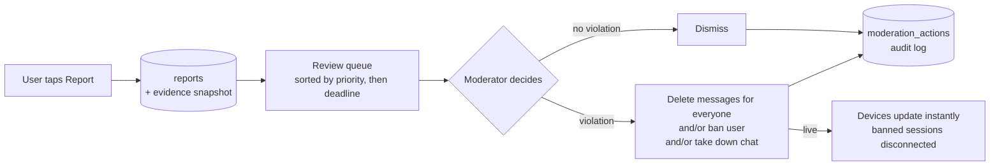

# Wasla — Moderation and Legal Requests

Status: **Built.** Backend and admin panel in Sprint 1; in-app Report/Block buttons, takedown enforcement and moderator alerts in Sprint 2.

Why this was built first: the CMC blocked Telegram in Iraq on 16 Nov 2026 for failing to deal with illegal content ([proposal §0](00-proposal-lean-mvp.md)). Wasla must be able to show, at any time, that it receives reports, acts on them quickly, and keeps a complete record.

## 1. How a report flows



- **Evidence is copied when the report is filed.** Even if the offender deletes the messages, the moderator still sees exactly what was reported.
- **Report and block in one step.** The user can block the offender at the same time as reporting.
- **No flooding.** Repeating the same report within 24 hours returns the existing report, and each user can file at most 20 reports per hour.
- **Members only.** Users can only report chats they are members of.

## 2. Priorities and deadlines

| Priority | Report reasons | Deadline to act |
|---|---|---|
| **Critical** | Child abuse, terrorism | **1 hour** |
| **High** | Violence, illegal goods, scams | 4 hours |
| **Normal** | Spam, harassment, pornography, personal data, fake accounts, copyright, other | 24 hours |

Overdue reports are shown in red at the top of the queue. The deadlines are settings (`moderation.DefaultSLA`) and **should be confirmed by legal counsel** against the CMC framework.

## 3. What moderators can do

| Action | Effect | Who |
|---|---|---|
| Dismiss | Closes the report as "no violation" | Everyone |
| Delete messages | Wipes the content for everyone. Every member's devices remove it immediately, or on next connect if offline. | Everyone |
| Ban user (up to 7 days) | All sessions are logged out and disconnected at once. The phone number cannot request login codes, and **the ban survives account deletion**. All other open reports about that user are closed. | Everyone |
| Ban user (30 days or permanent) | Same as above | Senior moderator and up |
| Lift ban | Removes the ban and the phone block | Senior moderator and up |
| Take down chat | The chat disappears for every member | Senior moderator and up |
| Add to media blocklist | Files with this SHA-256 fingerprint will be rejected at upload, and a critical report opened automatically. Enforcement starts with media uploads in weeks 9–10. | Senior moderator and up |
| Legal requests | Register, carry out and close requests from authorities | Admin |

**Every action requires a written reason** and is stored in the audit log with the moderator's name and time. The log cannot be edited from the panel.

## 4. Requests from authorities (CMC, courts, police)

The panel includes a **legal requests** register (admins only):

1. **Register** the request: authority, official reference number, type (content removal / account suspension / user data), deadline, full text, and the targets (`user 123`, `chat 456`, `message 456 12,13`).
2. **Record legal counsel's review** of the legal basis *before* acting. The panel warns when no review has been recorded.
3. **Carry out** each target with one click. These actions are linked to the request in the audit log.
4. **Close** the request with the outcome (complied / partially complied / rejected for insufficient legal basis) and the text of the response sent.

> Requests for **user data** are recorded here, but there is no automatic data export. Counsel must define the handover procedure first.

## 5. The admin panel

- Arabic, right-to-left, with light and dark modes. It is server-rendered with no JavaScript, so it works on any browser.
- **Login security:**
  - Email, password, and a 6-digit code from an authenticator app (TOTP). Each code can be used only once.
  - At most 10 login attempts per 15 minutes per IP address and per email.
  - Sessions expire after 8 hours.
  - Cookies are HttpOnly, Secure and SameSite=Strict, every form carries a CSRF token, and a strict Content-Security-Policy is set.
- **Network:** the panel runs on its own port (`WASLA_ADMIN_ADDR`, local-only by default). In production it must be reached only through a separate hostname behind an IP allowlist or VPN.

Creating a staff account prints a one-time password and the TOTP secret:

```bash
make staff EMAIL=moderator@wasla.app NAME="اسم المشرف" ROLE=1
```

Roles: `1` moderator, `2` senior moderator, `3` admin.

## 6. Still to do

| Item | When |
|---|---|
| ~~Report and Block buttons in the app~~ | ✅ Sprint 2: long-press a message → Report; chat menu → Report / Block; "report and block" in one step |
| ~~Messaging refuses taken-down chats~~ | ✅ Sprint 2: they vanish from the chat list and history, and nobody can post in them |
| Media blocklist check on upload | Weeks 9–10, with media |
| Moderator team: at least 2 Arabic-speaking moderators covering 08:00–24:00 Baghdad time, plus an on-call senior moderator for critical reports at night | Before public launch (your hiring decision) |
| ~~Alert to the on-call moderator when a critical report arrives~~ | ✅ Sprint 2: set `WASLA_ALERT_WEBHOOK_URL` to a Slack/Mattermost-style webhook; it is called for every child-abuse or terrorism report |
| Monthly transparency numbers (reports received, actioned, median time to act) for the CMC | After launch |
| Legal: confirm takedown deadlines, user-data request procedure, and child-abuse reporting obligations under Iraqi law | Counsel |
