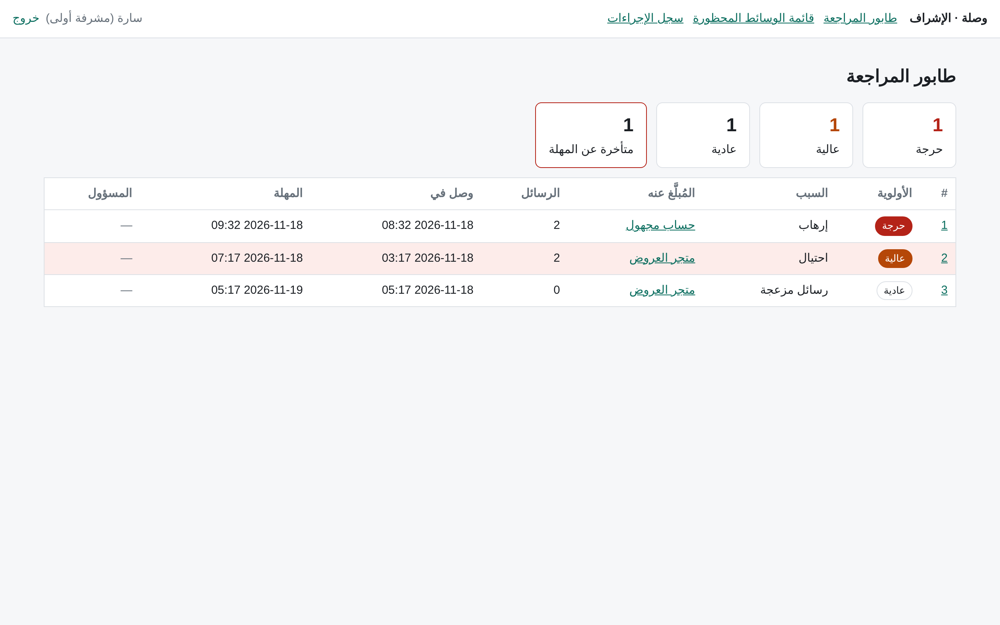
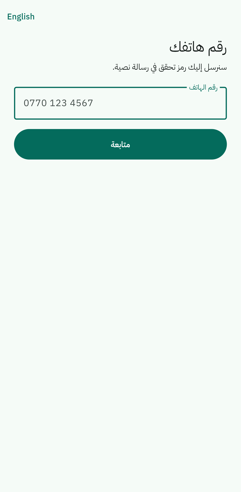

# Wasla: weekly progress, week 1 (Sprint 1 started)

**Date:** 18 November 2026 · **Overall: on track ✅**

## What's done this week

**1. The plan is approved and the code is on GitHub.** The architecture documents, database design and app–server "language" (protocol) are in your private repository. Every change is checked automatically by GitHub before it's accepted.

**2. Moderation is built first, as you asked.** Telegram was blocked in Iraq for not removing illegal content, so Wasla now has:

- **Reporting:** users can report a person, a chat, or specific messages, and block them in the same step. A copy of the reported messages is saved, so deleting them later doesn't destroy the evidence.
- **A review queue for moderators,** in Arabic. The most dangerous reports (child abuse, terrorism) go to the top with a **1-hour deadline**. Late reports turn red.
- **Takedowns:** a moderator can delete messages for everyone, ban a user (they're logged out instantly and their number can't sign up again, even if they delete the account), or shut down a whole chat.
- **A full record:** every moderator action is saved with who did it, when and why, and can't be edited. This is what you show the CMC.
- **A register for official requests** from the CMC, courts or police, with space for your lawyer's review before anything is done.

**3. Sign-up and login work, in the real app and on the real server:**

- Phone number → 5-digit code → name.
- Optional two-step password.
- A list of logged-in devices, with the option to log any of them out.
- Protection against SMS fraud (people abusing the code system to run up your SMS bill).
- The app is in Arabic, laid out right-to-left, with an English switch. It also accepts phone numbers typed with Arabic digits (٠٧٧٠…).

## How we know it works

- About 35 automatic tests check the server and the app every time code changes, including a test where the real app talks to the real server.
- Bugs found and fixed this week (before any user saw them):
  - A "wait 60 seconds" message was wrongly using up the user's hourly limit for login codes.
  - The confirmation for "log out" was sometimes lost.
  - Official requests that listed message numbers with spaces were read incorrectly.

## Next week

- Start **chats**: sending and receiving text messages, the chat list, read ticks (✓✓) and "typing…".
- Add the **Report** and **Block** buttons inside chats, connected to the moderation system above.
- Alert the on-call moderator immediately when a critical report arrives.

## What we need from you

1. **Legal counsel:**
   - Do the CMC rules require servers inside Iraq?
   - How fast must content be removed? We used 1 hour / 4 hours / 24 hours as a starting point.
   - What is the procedure when authorities ask for user data?
2. **D-U-N-S number and the Google Play organization account:** you're on this ✅.
3. **SMS providers:** we need two companies that deliver codes to Asiacell, Zain and Korek. If you have contacts, send them; otherwise we'll shortlist options.
4. **Logo and brand colours** by next week. The app currently uses temporary green.
