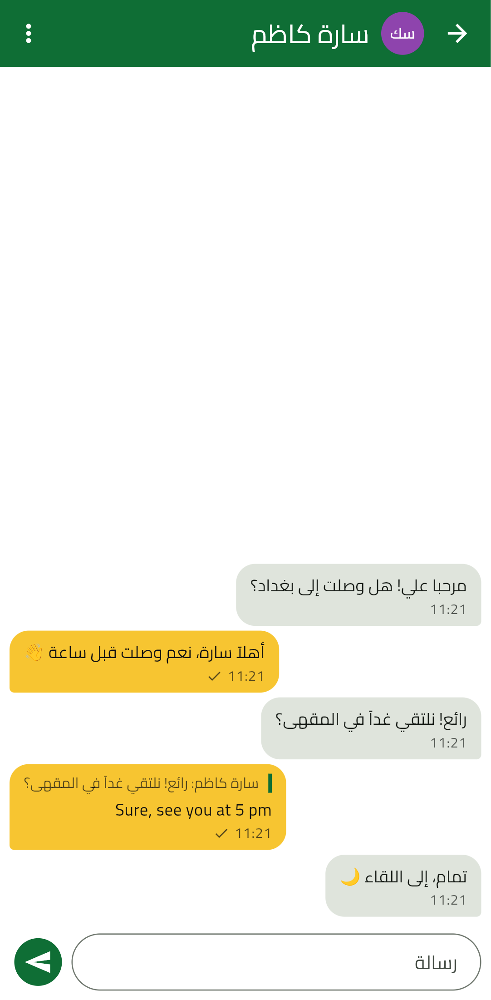

# Wasla: weekly progress, week 2 (Sprints 2 and 3)

**Date:** 19 November 2026 · **Overall: on track ✅, with one small fix needed from you**

## What's done this week

**1. Chatting works.** Sprint 1 (login, moderation) and Sprint 2 (chats) are merged into the main version:

- **Messages:** private chats, the chat list, read ticks (✓✓) and "typing…". You can reply, edit, delete, forward and pin.
- **Report and Block:** both buttons are inside every chat. A report goes straight into the moderators' queue.

**2. The app works without internet** (waiting for your merge, pull request #3). Your chats are saved on the phone:

- The app opens instantly, even with no signal.
- When the connection comes back, it catches up with everything it missed.
- Messages written offline are sent automatically.
- Logging out wipes the phone's copy.

**3. The final Wasla look is in** (pull request #3):

- The yellow-and-green logo as the phone icon, on both light and dark backgrounds.
- The brand colours and the Cairo font.
- The app's permanent name on Google Play: `iq.wasla.messenger`.

**4. Photos and files** (pull request #3):

- **Sending:** photos from the gallery or camera, and any file up to 500 MB, with a caption.
  - Photos are made smaller on the phone before sending, so they use less data.
  - The hidden location information inside photos is removed, for privacy.
- **Viewing:** tap a photo to see it full-screen and zoom in. Files show their name and size; tap to download and open.
- **Profile photos.** People who hide their photo in privacy settings show their initials instead.
- **Moderation:** every uploaded file is checked against a list of banned files.
  - A banned file is refused, and moderators get a report automatically.
  - If moderators ban a file later, it disappears from every chat it was sent to.

**5. Notifications when the app is closed** (pull request #4):

- When someone writes to you while Wasla is closed, the phone shows "لديك رسالة جديدة". Tapping it opens that chat.
- **Privacy:** the notification never contains the message or the sender's name, so Google (which delivers notifications) never sees what people write.
- Muted chats don't send notifications.

## How we know it works

- About 80 automatic tests run on every change, up from about 35 last week.
- **Real-system test:** the real app and the real server, with real file storage, sign up two people, send a photo and a 6 MB file, and check the other person receives exactly the same file. It also checks that a stranger can't download it.
- **Bugs caught before any user saw them:**
  - Photos could freeze while loading. The cause was a mistake in how the app waited for downloads.
  - A file waiting to be sent could have been lost if the app closed.
- **Not yet tried on a real phone:** notifications. That needs pull requests #3 and #4 merged first; then the staging app can be installed.

## ⚠️ One check is red

The automatic checks for pull request #4 (notifications) are failing. The code isn't the problem: the `GOOGLE_SERVICES_JSON` secret you added in GitHub doesn't contain the Google file. It should start with `{`, but what's saved there starts with a letter or digit. The steps to fix it are in the list below; it takes about 2 minutes.

## Next week

- Sprint 4 starts with **updating Go**, the programming language the server is written in, to the newest version that still gets security fixes. You asked for this to come first, and it must be done before launch.
- **Encrypt the messages stored on the phone,** so a lost phone doesn't expose chats.
- **Small groups** in the app.
- **Test notifications on a real phone** once #3 and #4 are merged.

## What we need from you

1. **Merge pull request #3** (photos, files, offline mode, brand). It's ready and every check is green. It was still marked "draft" earlier, which blocks merging. I've changed that, so the merge button works now.
2. **Re-paste the `GOOGLE_SERVICES_JSON` secret:**
   1. In the Firebase console, open Project settings → General → Your apps → Wasla Android and download `google-services.json`.
   2. Open the file in a text editor, select all and copy.
   3. In GitHub, go to Settings → Secrets and variables → Actions, choose `GOOGLE_SERVICES_JSON` → **Update**, paste and save.
   4. Tell me, and I'll re-run the checks.
3. **Then merge pull request #4** (notifications).
4. **Still open from last week:**
   - Legal answers (servers inside Iraq? takedown deadlines? data requests?).
   - SMS provider contracts for Asiacell, Zain and Korek.
   - Hiring moderators before launch.
